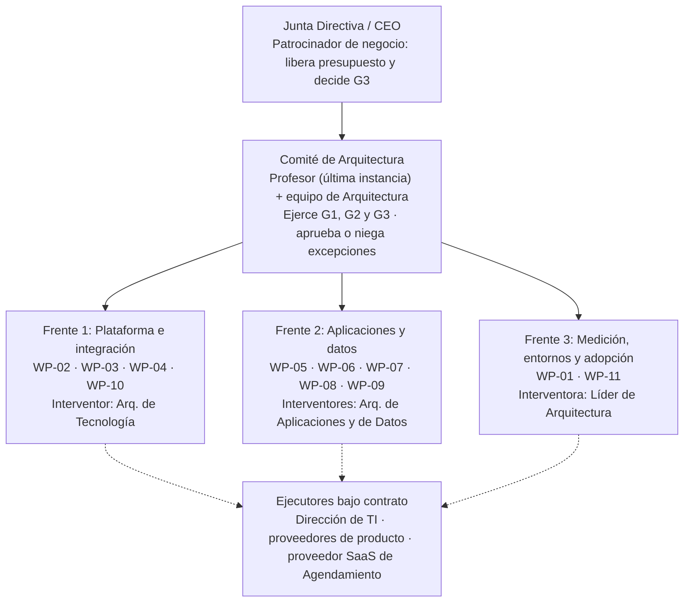
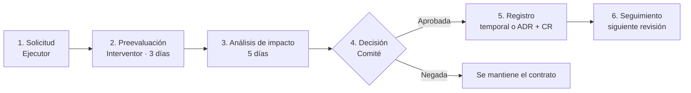

# Fase G: Gobierno de la Implementación — SaludCoop IPS

Proyecto de la asignatura **Arquitectura de Sistemas II** (Universidad Central, 2026), desarrollado con el método ADM de TOGAF sobre el caso de estudio **SaludCoop IPS**. Este repositorio documenta la Fase G: el gobierno de la construcción del MVP de la Región Central, para garantizar que lo que se implementa corresponda a lo diseñado en las Fases B, C y D y planificado en las Fases E y F.

| Integrante | Rol en el proyecto |
|---|---|
| Violeta Sofía Carrasquilla | Líder de Arquitectura Empresarial / Arquitecta de Negocio |
| Diego Ferney Rojas Romero | Arquitecto de Datos |
| Andres Felipe Correcha Meneses | Arquitecto de Aplicaciones e Integración |
| Nicolas Steven Romero León | Arquitecto de Tecnología |

**Profesor:** Oscar Darío Sánchez Pérez

---

## Contenido

1. [Contexto](#1-contexto)
2. [Objetivos de la fase](#2-objetivos-de-la-fase)
3. [Estilo arquitectónico: monolito modular](#3-estilo-arquitectónico-monolito-modular)
4. [Estructura de gobierno](#4-estructura-de-gobierno)
5. [Contrato de Arquitectura (JSON)](#5-contrato-de-arquitectura-json)
6. [Decisiones de producto (ADR)](#6-decisiones-de-producto-adr)
7. [Correspondencia ABB → SBB](#7-correspondencia-abb--sbb)
8. [Evaluación de la conformidad](#8-evaluación-de-la-conformidad)
9. [Procedimiento de excepciones](#9-procedimiento-de-excepciones)
10. [Integración con Scrum y DevOps](#10-integración-con-scrum-y-devops)
11. [Solicitudes de cambio](#11-solicitudes-de-cambio)
12. [Cierre y entrega a la Fase H](#12-cierre-y-entrega-a-la-fase-h)
13. [Estructura del repositorio](#13-estructura-del-repositorio)

---

## 1. Contexto

SaludCoop IPS opera cuatro sistemas heredados con paradigmas distintos, conectados por seis integraciones punto a punto (SQL directo, FTP nocturno y Excel manual):

| Sistema | Paradigma | Problema principal |
|---|---|---|
| APP-01 Historia Clínica en Línea (HCL) | Monolito | Bloqueos de tabla por consultas SQL directas de Telemedicina |
| APP-02 SHEC | N-Capas con tabletas SQLite fuera de línea | Sobrescrituras por sincronización FTP nocturna |
| APP-03 Telemedicina | Microservicios | Límite de 5 conexiones simultáneas y errores 504 |
| APP-04 Agendamiento | SaaS de tercero | Citas a pacientes inhabilitados y sobreagendamiento |

La arquitectura objetivo reemplaza esas conexiones por una **capa de interoperabilidad central** (API Gateway, servidor HL7 FHIR R4, broker de mensajería, MPI y Visor Clínico Único). El MVP se ejecuta en la Región Central con un presupuesto de referencia de **COP $450.000.000**, en dos arquitecturas de transición:

- **TA-1 (meses 9 y 10):** plataforma segura y cierre del SQL directo Telemedicina–HCL. Puerta **G1**.
- **TA-2 (meses 10 y 11):** MPI, sincronización SHEC–HCL, Agendamiento validado, Visor y auditoría. Puerta **G2**.
- **TA-3 (mes 12 en adelante):** escalamiento nacional, fuera del alcance de esta fase. Puerta **G3**.

La Fase G gobierna los paquetes de trabajo **WP-01 a WP-11**.

## 2. Objetivos de la fase

1. **Asegurar la conformidad** de TA-1 y TA-2 con los principios, requisitos y vistas aprobados.
2. **Ejercer la interventoría técnica** para evitar que se reintroduzcan conexiones punto a punto o tecnologías fuera del catálogo (riesgo R04).
3. **Formalizar el Contrato de Arquitectura**, con reglas verificables y trazables a los requisitos RT-01 a RT-16.
4. **Controlar la transición de ABB a SBB**, cerrando la selección de productos.
5. **Administrar excepciones y cambios** con un proceso formal integrado a las prácticas ágiles.

## 3. Estilo arquitectónico: monolito modular

El desarrollo a la medida (MPI y Visor Clínico Único) se construye como **un monolito modular**, llamado **Núcleo Clínico**, y no como microservicios: un único código fuente, un único artefacto desplegable y una base de datos PostgreSQL con un esquema por módulo.

| Fundamento | Explicación |
|---|---|
| Capacidad del equipo | La Dirección de TI aporta 23,5 personas-mes; varios servicios independientes exceden esa capacidad. |
| Plazo | Solo hay tres meses para construir y operar el MVP (R11). |
| Consistencia del dato maestro | El MPI requiere transacciones consistentes sobre la identidad del paciente (principio Dato Clínico Único). |
| Operación 24/7 | La disponibilidad de 99,9 % se logra con dos instancias del mismo artefacto en activo-activo. |
| Coherencia con la base instalada | La HCL, sistema crítico, ya es monolítica. |

La modularidad se protege con reglas que verifica el pipeline: los módulos solo se comunican por interfaces internas declaradas, ninguno accede al esquema de otro y todo intercambio externo cruza el API Gateway. Telemedicina conserva sus microservicios existentes, pero no se le agregan servicios nuevos.

## 4. Estructura de gobierno



## 5. Contrato de Arquitectura (JSON)

El contrato es el SLA técnico de la arquitectura entre el Comité y quienes implementan. Se firma en **H3 (mes 8)** y rige hasta **G3 (mes 12)**. Está versionado en [`docs/architecture-contract.json`](docs/architecture-contract.json); el pipeline lee de ese archivo el stack permitido y las prohibiciones, por lo que **modificarlo requiere una solicitud de cambio aprobada por el Comité**.

```json
{
  "contrato": "Contrato de Arquitectura",
  "version": "1.0",
  "proyecto": "SaludCoop IPS - MVP Región Central",
  "fase": "Fase G - Gobierno de la Implementación",
  "vigencia": {
    "firma": "H3 (mes 8)",
    "cierre": "G3 (mes 12)"
  },
  "alcance": {
    "paquetes": "WP-01 a WP-11",
    "transiciones": ["TA-1", "TA-2"],
    "fuera_de_alcance": ["WP-12", "WP-13"]
  },
  "partes": {
    "autoridad": "Comité de Arquitectura (profesor como última instancia)",
    "administrador": "Líder de Arquitectura",
    "ejecutores": [
      "Dirección de TI",
      "Proveedores de gateway, broker, servidor FHIR e identidad",
      "Proveedor SaaS de Agendamiento"
    ]
  },
  "clausulas": [
    {
      "id": "C-01",
      "clausula": "Estilo de construcción",
      "exigencia": {
        "estilo": "Monolito modular (Núcleo Clínico: MPI + Visor)",
        "stack": ["Java", "Spring Boot", "PostgreSQL"],
        "prohibido_sin_excepcion": ["Nuevos microservicios", "Bases de datos fuera del catálogo"]
      },
      "trazabilidad": ["ADR-01", "CR-08"]
    },
    {
      "id": "C-02",
      "clausula": "Integración",
      "exigencia": {
        "canal_unico": "API Gateway (TEC-10) con contrato de API versionado",
        "estandar": "HL7 FHIR R4",
        "recursos": ["Patient", "Encounter", "Observation", "Schedule", "Slot", "Appointment"]
      },
      "trazabilidad": ["API-First", "RT-13", "K-05", "K-06"]
    },
    {
      "id": "C-03",
      "clausula": "Sincronización asíncrona",
      "exigencia": {
        "integracion": "SHEC -> HCL por colas durables en el broker (TEC-11)",
        "reconciliacion": "Marca de tiempo por evento"
      },
      "trazabilidad": ["RT-06", "RT-15", "K-08"]
    },
    {
      "id": "C-04",
      "clausula": "Identidad del paciente",
      "exigencia": "Validar paciente y estado en el MPI antes de registrar o agendar",
      "trazabilidad": ["Dato Clínico Único", "K-07"]
    },
    {
      "id": "C-05",
      "clausula": "Seguridad",
      "exigencia": {
        "datos_en_transito": "TLS 1.3 en el 100 % de los endpoints",
        "datos_en_reposo": "AES-256 en MPI y auditoría; llaves en TEC-18",
        "identidad": "OAuth 2.0 / OIDC con SSO (TEC-15)",
        "roles": ["Medicina", "Enfermería", "Administración"]
      },
      "trazabilidad": ["RT-01", "RT-02", "RT-07"]
    },
    {
      "id": "C-06",
      "clausula": "Datos no productivos",
      "exigencia": "Solo datos tokenizados o pseudonimizados (Ley 1581 de 2012)",
      "trazabilidad": ["RT-09"]
    },
    {
      "id": "C-07",
      "clausula": "Auditoría",
      "exigencia": "Todo acceso o cambio clínico en registro inmutable append-only (TEC-16)",
      "trazabilidad": ["RT-08", "K-02"]
    },
    {
      "id": "C-08",
      "clausula": "Disponibilidad y despliegue",
      "exigencia": {
        "sla": "99,9 % en API Gateway y Visor Clínico Único",
        "topologia": "Activo-activo, 2 instancias (gateway y Núcleo Clínico)",
        "despliegue": "Blue-green, sin ventana de apagado"
      },
      "trazabilidad": ["RT-03", "RT-10", "K-03"]
    },
    {
      "id": "C-09",
      "clausula": "Resiliencia",
      "exigencia": {
        "gateway": ["Limitación de tasa", "Circuit breaker"],
        "exceso_de_solicitudes": "Rechazo con HTTP 429"
      },
      "trazabilidad": ["RT-04", "RT-05"]
    },
    {
      "id": "C-10",
      "clausula": "Capacidad",
      "exigencia": {
        "telemedicina": "Mínimo 20 conexiones simultáneas sin errores 504",
        "gateway": "Umbral fijado por el Comité en G1 con la demanda medida en WP-01"
      },
      "trazabilidad": ["RT-11", "WP-04"]
    },
    {
      "id": "C-11",
      "clausula": "Observabilidad",
      "exigencia": "Trazas extremo a extremo y medición continua de K-03 (TEC-19)",
      "trazabilidad": ["RT-14"]
    },
    {
      "id": "C-12",
      "clausula": "Prohibiciones",
      "exigencia": {
        "sql_directo_entre_sistemas": "PROHIBIDO",
        "lotes_ftp": "PROHIBIDO",
        "intercambio_manual_excel": "PROHIBIDO",
        "vigente_desde": "Cierre del paquete que reemplaza cada mecanismo"
      },
      "trazabilidad": ["API-First", "R04", "K-05"]
    },
    {
      "id": "C-13",
      "clausula": "Transición",
      "exigencia": {
        "ftp_en_paralelo": "10 días corridos (quincenas 10-2 a 11-1)",
        "excel_agendamiento": "Modo degradado hasta activar INT-02 (11-1)",
        "reversion": "Según Tabla 13.15"
      },
      "trazabilidad": ["Fase F, Tabla 13.15"]
    },
    {
      "id": "C-14",
      "clausula": "Respaldo",
      "exigencia": "Respaldo verificado de HCL y MPI antes de cada activación (TEC-21)",
      "trazabilidad": ["RT-15", "RM-01"]
    }
  ],
  "conformidad": {
    "niveles": ["CONFORME", "EXCEPCION", "NO_CONFORME"],
    "revisiones": ["RC-1 (G1)", "RC-2 (G2)", "RC-3 (G3)", "Continua (cada sprint)"]
  },
  "excepciones": {
    "procedimiento": "Numeral 14.9",
    "no_negociables": ["C-05", "C-06", "C-07"],
    "vencimiento_maximo": "G3"
  }
}
```

**Firmantes**

| Firmante | Compromiso |
|---|---|
| Comité de Arquitectura | Aprueba el contrato, ejerce las puertas y resuelve excepciones. |
| Líder de Arquitectura | Administra el contrato y los registros de excepciones y decisiones. |
| Dirección de TI | Construye conforme al contrato y aplica CR-01 a CR-05 en los cuatro sistemas. |
| Proveedores de gateway, broker, FHIR e identidad | Configuran sus productos conforme a C-02, C-05, C-08 y C-09. |
| Proveedor SaaS de Agendamiento | Firma el contrato de capacidad y SLA (quincena 10-1) y consume INT-02. |

## 6. Decisiones de producto (ADR)

La Fase D propuso candidatos que no se cerraron en las Fases E y F. El Comité los cierra en esta fase (CR-07) con los criterios de la Fase D: soporte de estándares, costo total, compatibilidad con el hospedaje, alta disponibilidad y facilidad de reemplazo.

| ADR | Decisión | Alternativas | Elección |
|---|---|---|---|
| ADR-01 | Estilo del desarrollo a la medida | Microservicios; monolito modular | Monolito modular (Java, Spring Boot, PostgreSQL) |
| ADR-02 | API Gateway (TEC-10) | Kong, WSO2, Azure API Management | Kong Gateway |
| ADR-03 | Servidor FHIR (TEC-12) | HAPI FHIR, Microsoft FHIR Server | HAPI FHIR (servidor JPA) |
| ADR-04 | Broker (TEC-11) | RabbitMQ, Kafka | RabbitMQ |
| ADR-05 | Identidad (TEC-15) | Keycloak, Entra ID | Keycloak |
| ADR-06 | Llaves y secretos (TEC-18) | HashiCorp Vault, Key Vault | HashiCorp Vault |
| ADR-07 | Auditoría (TEC-16) | WORM + OpenSearch | Se ratifica |
| ADR-08 | Monitoreo (TEC-19) | OpenTelemetry + Grafana | Se ratifica |
| ADR-09 | Entornos y pipeline (TEC-20) | GitLab CI, Jenkins | GitLab CI |
| ADR-10 | Clúster (TEC-17) | Kubernetes, máquinas virtuales | Máquinas virtuales con balanceador |

Las justificaciones completas están en [`docs/adr/`](docs/adr/). Las versiones se fijan al adquirir cada producto (versión estable con soporte vigente).

## 7. Correspondencia ABB → SBB

| ABB | SBB | WP |
|---|---|---|
| APP-05 / TEC-13 MPI | Módulo MPI del Núcleo Clínico (PostgreSQL + pgcrypto) | WP-07 |
| TEC-22 Gestión de datos maestros | Componente del módulo MPI | WP-07 |
| APP-06 / TEC-14 Visor Clínico Único | Módulo Visor del Núcleo Clínico (interfaz web del mismo artefacto) | WP-09 |
| APP-07 / TEC-10 API Gateway | Kong Gateway, 2 nodos activo-activo | WP-03 |
| TEC-12 Transformación y repositorio FHIR | HAPI FHIR R4 | WP-03 |
| TEC-11 Broker de eventos | RabbitMQ, clúster de 3 nodos | WP-06 |
| TEC-15 Identidad | Keycloak (OIDC, SSO, MFA) | WP-02 |
| TEC-18 Llaves y secretos | HashiCorp Vault | WP-02 |
| TEC-16 Auditoría inmutable | OpenSearch + almacenamiento WORM | WP-10 |
| TEC-17 Clúster | Máquinas virtuales con balanceador | WP-04 |
| TEC-19 Monitoreo | OpenTelemetry + Grafana | WP-04 |
| TEC-20 Entornos y despliegue | GitLab CI, entornos dev / pruebas / prod, blue-green | WP-01 |
| TEC-21 Respaldo | Política de respaldo de HCL y MPI | WP-04 |
| TEC-23 Gestión de dispositivos móviles | Herramienta para tabletas de SHEC (se selecciona en WP-06) | WP-06 |
| APP-01 HCL (existente) | Monolito refactorizado: expone FHIR y cierra el SQL directo | WP-05 |
| APP-03 Telemedicina (existente) | Microservicios escalados a mínimo 20 conexiones | WP-04 |

## 8. Evaluación de la conformidad

| Nivel | Criterio | Consecuencia |
|---|---|---|
| **CONFORME** | Cumple todas las cláusulas aplicables, incluidas las de transición (C-13). | Se promueve a producción. |
| **EXCEPCIÓN** | Desviación justificada, con alternativas evaluadas y plan de retiro. | Solo se despliega si el Comité la aprueba. |
| **NO CONFORME** | Viola una cláusula sin excepción aprobada. | Se bloquea el despliegue y se corrige o se revierte. |

**Revisiones programadas**

| Revisión | Momento | Alcance | Evidencia |
|---|---|---|---|
| RC-1 | Antes de G1 (mes 10) | TA-1 | Pruebas del gateway, prueba de carga de Telemedicina, inventario sin SQL directo |
| RC-2 | Antes de G2 (mes 11) | TA-2 | K-03, K-05 y K-06 cumplidos; 10 días de conciliación SHEC–HCL; reversión probada |
| RC-3 | G3 (mes 12) | MVP completo | Tendencia de K-01 y K-02; excepciones cerradas |
| Continua | Cada sprint | Incremento | Resultados del pipeline y revisiones de código |

**Casos de evaluación**

| Situación | Nivel | Dictamen |
|---|---|---|
| FTP en paralelo durante 10 días para validar la sincronización | Conforme | Está prevista en C-13; extenderla requiere una excepción. |
| Base de datos NoSQL fuera del catálogo como caché del Visor | Excepción negada | El Visor no persiste datos clínicos; se usa caché en memoria del Núcleo Clínico. |
| Servicio independiente de notificaciones con base de datos propia | No conforme | Contradice ADR-01; se implementa como módulo del Núcleo Clínico. |
| Conexión SQL directa a la HCL para un reporte | No conforme | Viola C-12 y reactiva R04; el reporte se construye sobre la API del gateway. |

## 9. Procedimiento de excepciones



- No se aprueban excepciones sobre **C-05** (seguridad), **C-06** (datos no productivos) ni **C-07** (auditoría).
- Toda excepción temporal vence, como máximo, en G3.
- Los cambios de emergencia los aprueban dos miembros del Comité y se ratifican en la siguiente sesión (proceso ISO/IEC 20000).

## 10. Integración con Scrum y DevOps

| Práctica | Control de arquitectura |
|---|---|
| Planificación del sprint | El interventor define los límites técnicos; cada historia indica su WP y las cláusulas que toca. |
| Revisión de código | Los cambios en contratos de API, esquemas o dependencias requieren aprobación de un revisor de arquitectura. |
| Pipeline CI/CD | Ejecuta los controles automáticos; una falla bloquea la promoción. |
| Revisión del sprint | Se presenta la evidencia de conformidad del incremento. |
| Retrospectiva | Las desviaciones recurrentes se convierten en solicitudes de cambio o en nuevos controles. |

**Controles automáticos del pipeline**

| Control | Cláusula | Efecto |
|---|---|---|
| Pruebas de arquitectura del monolito (límites entre módulos) | C-01 | Bloquea |
| Dependencias fuera del stack de `architecture-contract.json` | C-01 | Bloquea |
| Cambios incompatibles en contratos OpenAPI y perfiles FHIR | C-02 | Bloquea |
| Conexiones a bases de datos de otros sistemas, FTP o Excel | C-12 | Bloquea |
| Secretos en el código y vulnerabilidades altas | C-05 | Bloquea |
| Datos personales reales en entornos no productivos | C-06 | Bloquea |
| Prueba de carga en preproducción | C-10 | Bloquea la promoción |
| Despliegue blue-green con chequeo de salud | C-08 | Revierte |

**Definición de terminado**

- [ ] Código probado, con pruebas automatizadas aprobadas
- [ ] Controles de arquitectura del pipeline aprobados
- [ ] Revisión de código aprobada (incluida la de arquitectura cuando aplica)
- [ ] Contrato de API y documentación actualizados
- [ ] Sin excepciones abiertas, o aprobadas por el Comité y registradas

## 11. Solicitudes de cambio

| ID | Cambio | Estado |
|---|---|---|
| CR-07 | Se incorporan al catálogo tecnológico los productos de ADR-02 a ADR-10. | Aprobada en H3 |
| CR-08 | APP-05 y APP-06 se reclasifican como módulos del monolito modular (antes, APP-05 figuraba como microservicio en la Fase C). | Aprobada en H3 |
| CR-09 | TEC-22 queda como gestión de datos maestros; la gestión de dispositivos móviles de las tabletas pasa a TEC-23. | Aprobada en H3 |

## 12. Cierre y entrega a la Fase H

- Comparación de los KPI con sus metas: K-03, K-05 y K-06 en H4; K-07 y K-08 en operación; tendencia de K-01 y K-02.
- Cierre de las excepciones abiertas o conversión en solicitudes de cambio.
- Actualización del repositorio de arquitectura con lo efectivamente implementado.
- Lecciones aprendidas de la construcción.
- Entrega a la Fase H del monitoreo de KPI y riesgos y de la solicitud de trabajo para TA-3 (WP-12 y WP-13).

## 13. Estructura del repositorio

```
.
├── README.md
├── CONTRIBUTING.md                  # Reglas para contribuir (stack, ramas, revisión)
└── docs/
    ├── architecture-contract.json   # Contrato de Arquitectura v1.0
    ├── adr/                         # ADR-01 a ADR-10
    └── Proyecto_SaludCoop_IPS_Fase_G.docx
```

Las contribuciones deben respetar el stack y las prohibiciones del contrato. Un pull request con un lenguaje o dependencia no soportados lo rechaza el pipeline y se cierra con referencia a la cláusula C-01 y al procedimiento de excepciones.

---

*Universidad Central · Bogotá D.C. · 2026*
